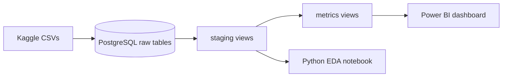

# MSME Lending Portfolio Analytics

A credit risk analysis built on 307,511 loan applicants from the Home Credit Default Risk dataset. It covers the full path a lending analyst walks: raw relational data in PostgreSQL, a SQL staging and metrics layer, and a Power BI dashboard, with every metric defined in writing.


## What the analysis answers

A lender running a loan book needs three answers, and the dashboard has one page for each:

1. **How much of the book is paying late, and how late?** (portfolio overview)
2. **How does delinquency develop as loans age, and do newer loans behave differently?** (vintage analysis)
3. **Which borrower groups carry the most risk?** (borrower risk profile)

## Key results

| Metric | Result |
|---|---|
| Applicants | 307,511 |
| Default rate | 8.07% (24,825 defaulted) |
| PAR30 / PAR60 / PAR90 (loans ever late, by count) | 2.32% / 1.02% / 0.83% |
| Loans ever 60+ days late that were also ever 90+ | about 81% |
| Cumulative 30+ day delinquency at month 12 | 0.67% (cohort Y-1) up to 5.45% (cohort Y-5) |
| Default rate by education | 10.93% (lower secondary) to 1.83% (academic degree) |

Read the findings in context in [PowerBI_Report](PowerBI_Report.md).

## Architecture



- **Raw tables:** `application_train`, `previous_application`, `installments_payments`, `pos_cash_balance`, `credit_card_balance`, `bureau`.
- **Staging (`staging.stg_*`):** six views that clean types and encodings, convert day offsets to age and employment years, and derive days past due per instalment.
- **Metrics (`metrics.*`):** DPD buckets, loan-level and borrower-level delinquency rollups, and vintage cohorts and curves.
- **Dashboard:** three Power BI pages on top of the views.

## Design decisions

- **PAR counts loans that were ever late.** The data has no outstanding-balance field, so a point-in-time PAR is not computable. The metric is labelled "ever late, by loan" everywhere it appears.
- **Vintage cohorts use a fixed population.** Each cohort contains every loan originated at least 365 days before the reference date. Eligibility depends on origination timing, not on whether the loan kept paying, because filtering on continued payment would drop early defaulters and bias the curve downward.
- **`365243` is treated as missing.** Home Credit uses it as a placeholder for "not currently employed" and in several date fields. Left in place, it reads as a 1,000-year employment tenure.
- **Income is capped at the 99th percentile for clustering only.** Three applicants report income above 10 million, which I treat as data artifacts. Scorecard binning absorbs them in the top bin.

## Repository layout

```
├── README.md
├── data/              raw CSVs (gitignored)
├── sql/
│   ├── 00_create_tables.sql
│   ├── 00_fix_data_types.sql
│   ├── staging/       01 to 06 staging views
│   └── metrics/       01_par_dpd, 02_vintage_cohort, 03_vintage_curve_view
├── notebooks/         01_eda.ipynb
├── dashboards/        Power BI file and screenshots
├── docs/              metrics_definitions.md, report.md
└── .env.example       database settings template
```

## Reproduce it

**Requirements:** PostgreSQL, Python 3 with `pandas`, `sqlalchemy`, `psycopg2`, `python-dotenv`, `matplotlib`, `seaborn` and `jupyter`, and Power BI Desktop.

1. Download the six CSVs from the [Home Credit Default Risk](https://www.kaggle.com/competitions/home-credit-default-risk/data) competition page into `data/raw/`. The data is not included here, and Kaggle's competition terms apply.
2. Create a database, then run `sql/00_create_tables.sql`.
3. Load each CSV with `\copy`. If any numeric column loads as text, run `sql/00_fix_data_types.sql`.
4. Run `sql/staging/01` to `06`, then `sql/metrics/01_par_dpd.sql`, `02_vintage_cohort.sql` and `03_vintage_curve_view.sql`, in that order.
5. Copy `.env.example` to `.env` and fill in your database settings. Run `notebooks/01_eda.ipynb`.
6. Open the Power BI file and point it at your server and database.

If the vintage view is slow on your machine, add indexes on `sk_id_prev` for `installments_payments` and `previous_application`.

## Documentation

- [metrics_definitions.md](metrics_definitions.md): how DPD, PAR, vintage and utilization are calculated, and what each one cannot tell you.
- [PowerBI_Report.md](PowerBI_Report.md): the full write-up of the data, method and findings.

## Limitations

- **Consumer credit, not MSME.** The patterns illustrate the method and do not describe small-business borrowers.
- **Relative dates.** Day offsets from a reference point replace calendar dates, so "vintage" means years before application, not calendar years.
- **PAR is an estimate.** See Design decisions.
- **Mixed units.** The dashboard counts applicants (default rate), loans (PAR) and instalments (DPD distribution). Each visual is labelled with its unit.
- **Small segments** (under 100 applicants) are excluded from the segment charts.

## Status

- [x] PostgreSQL schema, type repair and staging views
- [x] DPD, PAR and vintage metrics
- [x] Metrics definitions and EDA notebook
- [x] Power BI dashboard (overview, vintage, borrower profile)
- [ ] Risk watchlist page
- [ ] Sample weekly and monthly lender reports
- [x] Borrower segmentation (RFM and k-means)
- [x] Data quality checks tested against injected errors
- [ ] Scorecard prototype (WoE binning, logistic regression versus gradient boosting, KS/Gini/PSI)
- [ ] Data dictionary and SQL snippet library

## Author

Mote the Analyst | [LinkedIn](#) | [Portfolio](#)

**Stack:** PostgreSQL, SQL, Python (pandas, SQLAlchemy, matplotlib, seaborn), Power BI.
